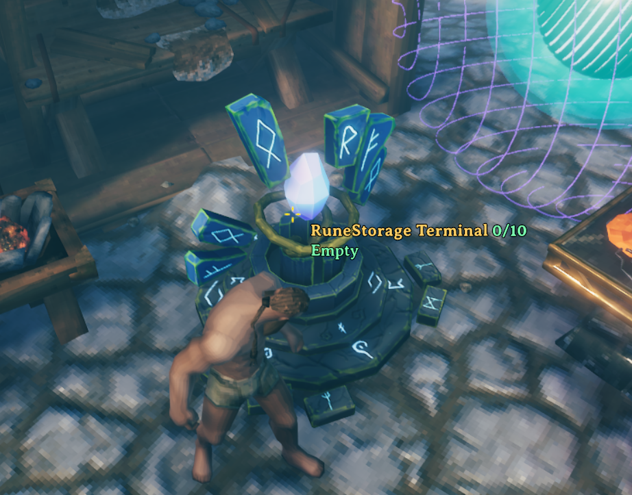
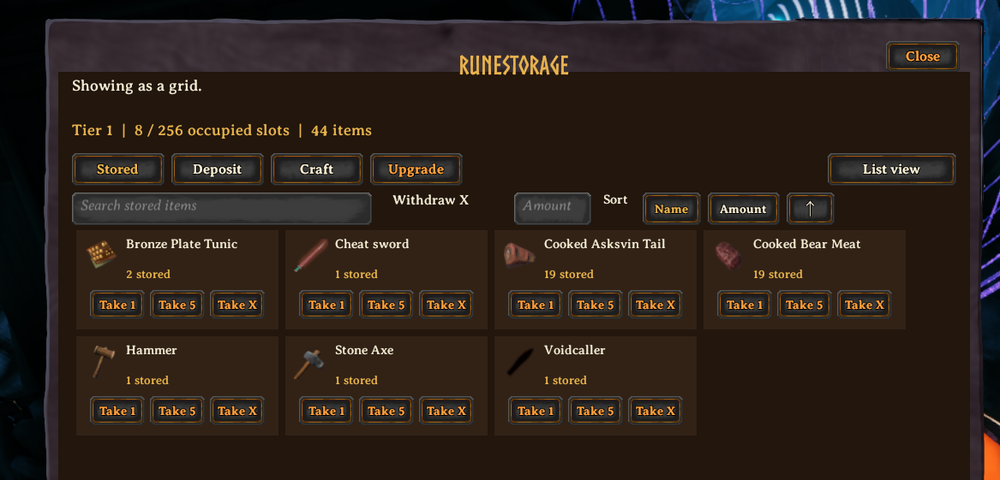

# RuneStorage

Place a terminal and a Core, and your storage becomes one searchable list. The Core keeps your items in a Valheim chest inventory. The terminal lets you deposit, withdraw, craft with what's stored, and upgrade the Core.





Version 0.1.0 is the first public release.

## What it does

- Two buildable pieces: the terminal you interact with, and the Core that holds the items.
- Search and sort. Matching stacks merge into one row. Items that differ in quality, durability, or crafter stay in separate rows.
- Crafting from stored items, as long as the recipe's station is nearby.
- Upgrades that raise the Core to 512 and then 1,024 slots, in place. Nothing already stored moves or gets lost.
- Anyone can use the Core and terminal, the same as a chest, unless a ward or private area blocks them.

## Costs

| Piece | Built at | Cost |
|---|---|---|
| RuneStorage Terminal | Hammer | 10 Fine Wood, 10 Stone, 2 Surtling Cores |
| RuneStorage Core, Tier I (256 slots) | Hammer, Forge nearby | 10 Bronze, 10 Fine Wood, 4 Surtling Cores |

| Upgrade | Slots | Station nearby | Cost |
|---|---|---|---|
| Tier II | 512 | Forge | 10 Iron, 10 Fine Wood, 4 Surtling Cores |
| Tier III | 1,024 | Blackforge | 10 Black Metal, 10 Fine Wood, 6 Surtling Cores |

Upgrade from the terminal's Upgrade tab. Pay from the Core's stored items, or switch the "Pay from" toggle to your own inventory. Equipped items are never used.

## Using it

1. Place a terminal and a Core within 12 meters of each other. A terminal needs one Core. If two Cores are in range, the terminal refuses to choose and says so.
2. Interact with the terminal.
3. **Stored tab:** take items out with Take 1, Take 5, or Take X. Sort by name or amount.
4. **Deposit tab:** put items in with Deposit 1, Deposit 5, Deposit X, or Deposit all for one item group. Deposit Everything moves all your unequipped items.
5. **Craft tab:** craft recipes from stored items. Each click crafts one recipe.
6. **Upgrade tab:** upgrade the Core.

Deposit Everything and "Deposit all" store as much as fits. Whatever doesn't fit stays in your inventory, and a stack can be split. Deposit 1, 5, and X are all-or-nothing: if the whole amount doesn't fit, nothing moves. Withdrawals are all-or-nothing too.

You can't remove a Core with the hammer while it holds items. Empty it first.

## Known limits

- **Disconnects:** there is no recovery journal. If you disconnect during a transfer to a remote Core, items can be duplicated or lost. Vanilla chests carry the same kind of risk.
- **Remote players:** the Core owner trusts the item data that remote players send for deposits and player-paid upgrades.
- **Destroyed Core:** the Core's items are not lost. Where they land and how to recover them is still to be documented.
- **Multiplayer:** not yet tested.

## Install

Install from Thunderstore with r2modman or the Thunderstore app. The package needs BepInExPack_Valheim and Jötunn 2.30.2.

Thunderstore: https://thunderstore.io/c/valheim/p/catosaurluna/RuneStorage/ (live after the first upload)

The Thunderstore README is at [packaging/thunderstore/README.md](packaging/thunderstore/README.md).

## Build from source

You need:
- The .NET 8 SDK, for `dotnet build` and the model tests.
- A Valheim install. The build reads Valheim and Unity assemblies from the default Steam path. Override it with `-p:ValheimDir="C:\path\to\Valheim"`.

BepInEx 5.4.23.6, 0Harmony, and Jötunn 2.30.2 are vendored under `lib/BepInEx`. See `lib/BepInEx/VENDORED.txt` for their sources.

```
dotnet build src/RuneStorage/RuneStorage.csproj -c Release
dotnet run --project tests/RuneStorage.ModelTests -c Release
```

If the RuneStorage Test r2modman profile exists, the build copies the Release DLL into its `BepInEx\plugins` folder.

## Documentation

- `DOCS/RUNESTORAGE_DEVPLAN.md`: the development plan, design decisions, and verification status.

## Credits

- [BepInEx](https://github.com/BepInEx/BepInEx), LGPL-3.0.
- [Harmony](https://github.com/pardeike/Harmony), MIT.
- [Jötunn](https://github.com/Valheim-Modding/Jotunn), MIT.

Valheim and its assets belong to Iron Gate Studio. They are not included in this repository.

## License

RuneStorage is released under the MIT License. See [LICENSE](LICENSE).

The vendored BepInEx files under `lib/BepInEx` keep their own license (LGPL-3.0). See `lib/BepInEx/VENDORED.txt`.
