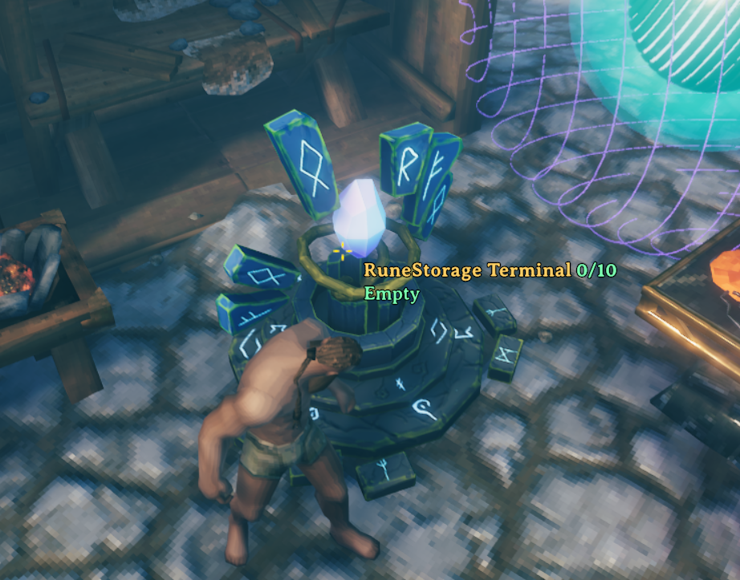

# RuneStorage

RuneStorage adds a buildable runestone terminal that gives you a searchable view of a nearby storage core. The core keeps the items in its own Valheim chest inventory. The terminal lets you deposit, withdraw, craft from stored items, and upgrade the core.

## Pieces and costs

**RuneStorage Terminal** (Hammer): 10 Fine Wood, 10 Stone, 2 Surtling Cores.

**RuneStorage Core, Tier I, 256 slots** (Hammer, needs a Forge): 10 Bronze, 10 Fine Wood, 4 Surtling Cores.

Upgrade the Core from the terminal's Upgrade tab. Upgrades keep everything already stored.

- **Tier II, 512 slots:** Forge nearby. 10 Iron, 10 Fine Wood, 4 Surtling Cores.
- **Tier III, 1,024 slots:** Blackforge nearby. 10 Black Metal, 10 Fine Wood, 6 Surtling Cores.

Upgrades can be paid from the Core's stored items, or from your own inventory with the "Pay from" toggle. Equipped items are never used.

## How to use it

1. Place a terminal and a Core within 12 meters of each other. Use one Core per terminal. If two Cores are in range, the terminal refuses to choose and tells you why.
2. Interact with the terminal.
3. **Stored tab:** take items out with Take 1, Take 5, or Take X. Sort by name or amount.
4. **Deposit tab:** put items in with Deposit 1, Deposit 5, Deposit X, or Deposit all for a whole item group. Deposit Everything moves all your unequipped items.
5. **Craft tab:** craft recipes with items stored in the Core. Each click crafts one recipe. The required crafting station must be nearby.
6. **Upgrade tab:** upgrade the Core.

Deposit Everything and "Deposit all" store as much as fits and leave the rest in your inventory. Deposit 1, 5, and X are all-or-nothing: if the whole amount doesn't fit, nothing moves. Withdrawals are all-or-nothing too.

Hammer removal is blocked while a Core still holds items. Empty it first.

Anyone can use the Core and terminal unless a ward or private area blocks them.

## Known limits

- **Disconnects:** there is no recovery journal. If you disconnect in the middle of a transfer to a remote Core, items can be duplicated or lost. Vanilla chests have the same kind of risk.
- **Remote trust:** the Core owner trusts the item data a remote player sends for deposits and player-paid upgrades.
- **Destroyed Core:** the Core's items are not lost when it is destroyed. The terminal holds no items.
- **Multiplayer:** not yet tested.

## Requirements

- BepInExPack_Valheim
- Jötunn 2.30.2

## Source and documentation

Source code, build instructions, and the development plan: https://github.com/ucwxcato/RuneStorage

## Credits

- [BepInEx](https://github.com/BepInEx/BepInEx), LGPL-3.0.
- [Harmony](https://github.com/pardeike/Harmony), MIT.
- [Jötunn](https://github.com/Valheim-Modding/Jotunn), MIT.
